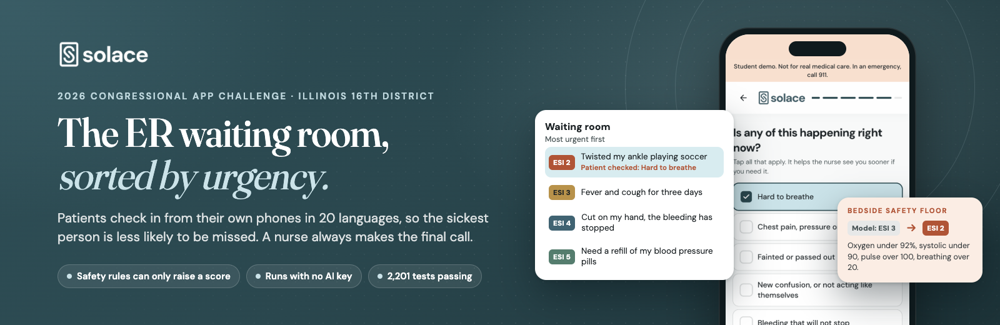
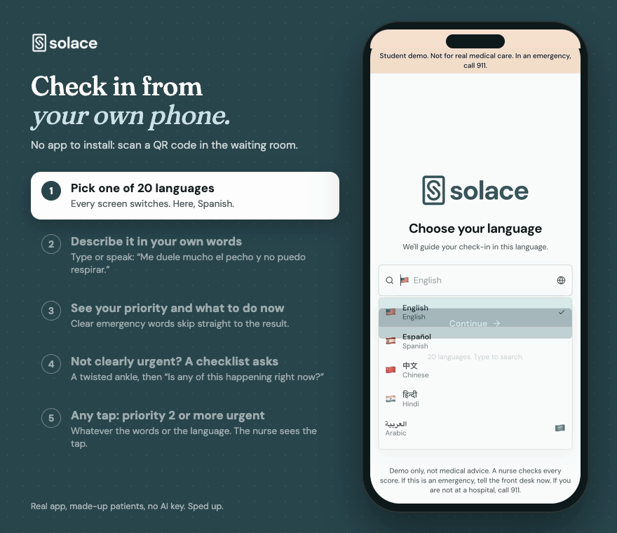
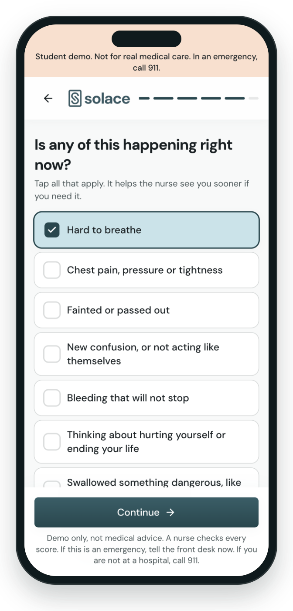
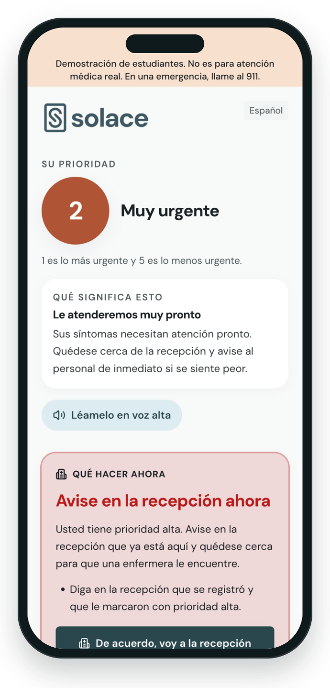
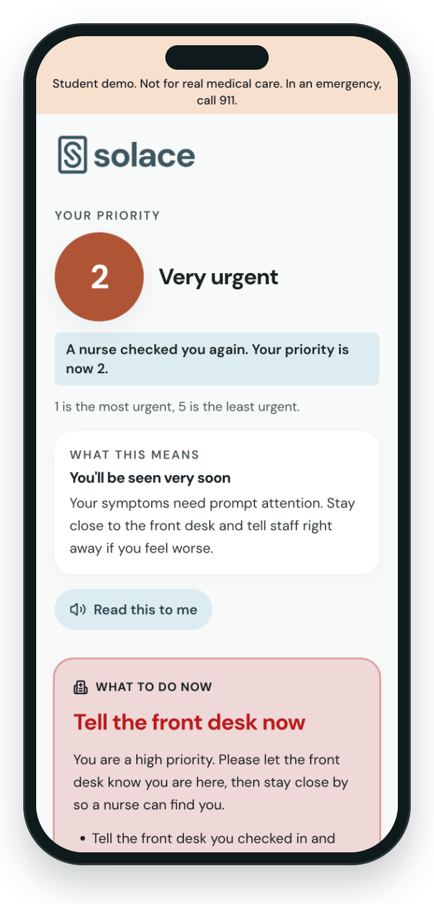
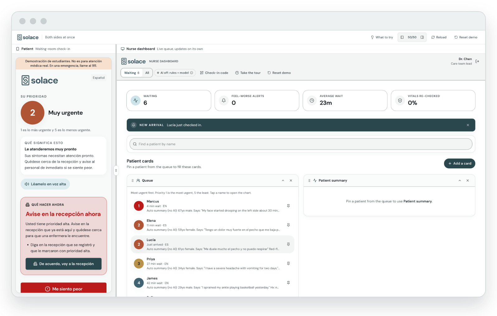
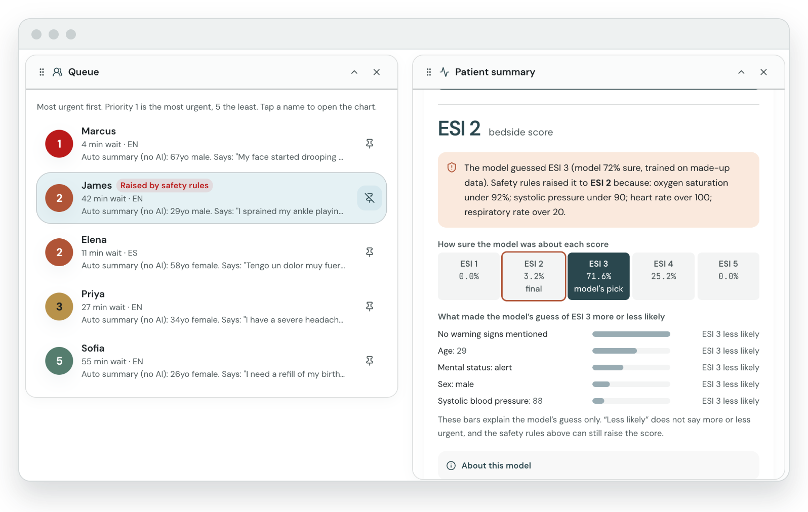
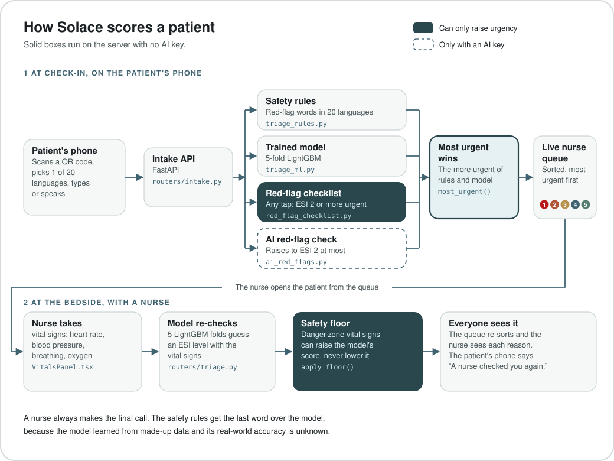
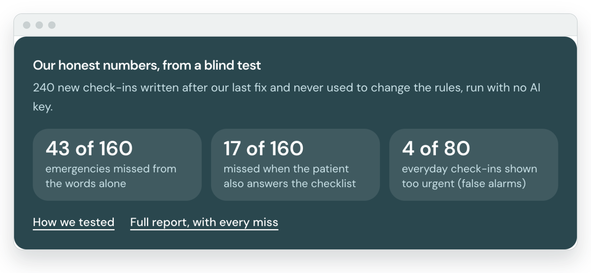

<p align="center">
  <a href="https://solace-cac.vercel.app"></a>
</p>

<h3 align="center">Solace sorts ER waiting-room patients by urgency from their own phones,<br>so the sickest person is less likely to be missed.</h3>

<p align="center">
  <a href="https://solace-cac.vercel.app"></a>
  <a href="#testing"></a>
  <a href="#what-is-new-in-this-version"></a>
  <a href="LICENSE"></a>
  <a href="#team"></a>
</p>

<p align="center">
  <b><a href="https://solace-cac.vercel.app">Try it live</a></b>
  &nbsp;·&nbsp; <a href="#demo-video">Demo video</a>
  &nbsp;·&nbsp; <a href="#try-it-in-60-seconds">Try it in 60 seconds</a>
  &nbsp;·&nbsp; <a href="#how-it-works">How it works</a>
  &nbsp;·&nbsp; <a href="#honest-testing">Honest testing</a>
  &nbsp;·&nbsp; <a href="CODE-TOUR.md">Code tour</a>
</p>

A patient scans a QR code in the waiting room, picks one of 20 languages, and describes
their symptoms by typing or talking. If the words do not already look like an emergency, a
short checklist asks "Is any of this happening right now?" and the patient taps any danger
sign that applies. Solace gives them an urgency level on the standard Emergency Severity
Index (ESI 1 is the most urgent, 5 the least) with plain guidance while they wait. The triage
nurse sees a live queue sorted by urgency. When the nurse takes vital signs at the bedside, a
trained machine learning model re-checks the patient, and a set of plain safety rules can
only raise the urgency, so the model cannot lower the score of an emergency the rules
recognize.

A 2026 Congressional App Challenge entry by **Namratha Dinesh**, **Sriyan Bodla**, **Dhruv
Jain** and **Akshaya Konjeti**, Illinois's 16th District.

> [!IMPORTANT]
> This is a student project with made-up patients. It is not for real medical use and has
> not been tested in a real hospital. The model was trained on synthetic (made-up) data. A
> nurse always makes the final call.

## Demo video

<a href="https://youtu.be/VeC7d-YxwWg"></a>

**Watch it here: <https://youtu.be/VeC7d-YxwWg>**

Under three minutes. It opens on a short scene we acted in an ER waiting room, where a
patient who only speaks Spanish is passed over. Then Sriyan shows the app working end to end,
from a Spanish check-in on a phone to the bedside safety floor raising a patient the model
scored too calmly; Dhruv walks through the code behind it; and Akshaya and Namratha close it.

## Try it in 60 seconds

Open **<https://solace-cac.vercel.app>**. There is no sign-up: every visitor
gets a private practice hospital with five made-up patients.

Straight to one side of the app (one shared demo hospital):
- Patient check-in: <https://solace-cac.vercel.app/patient>
- Clinician dashboard: <https://solace-cac.vercel.app/clinician> (sign in as Dr. Chen, PIN 224466)

| | Try this | What you should see |
|---|---|---|
| 1 | **Check in as a patient.** Pick Español, agree to the consent screen, skip the optional steps, and tap the example *"Me duele mucho el pecho y no puedo respirar"*. | Priority 2, *Muy urgente*, and a red card telling the patient to go to the front desk now, all in Spanish. |
| 2 | **Answer the checklist.** Check in again with the twisted-ankle example. When the app asks "Is any of this happening right now?", tap *Hard to breathe*. | The ankle alone is not urgent, but any tapped danger sign puts the score at ESI 2 or more urgent. |
| 3 | **Watch the safety floor.** Open the nurse dashboard and sign in as **Dr. Chen, PIN 224466**. Open James (sprained ankle, ESI 4). Under "Bedside vitals and re-check", enter blood pressure **88/54**, heart rate **124**, oxygen **91** percent and breathing rate **24**, then press "Re-check the score". | The model's own guess (ESI 3 for James in our test run), then the safety floor raising him to **ESI 2** with every reason listed. James moves up the queue with a "Raised by safety rules" tag. A patient re-checked this way sees "A nurse checked you again" on their own phone. |

<details>
<summary><b>More to explore</b> (the full tour, every page and the demo sign-ins)</summary>

<br>

- **The front page** (the live link, or <http://localhost:5173> when running locally) shows
  three ways in. Each one opens your own private demo hospital, with an id like
  `demo-k3x9q2` in the address, so you never see anyone else's test patients. "Start fresh"
  gives you a new one.
- **Check-in details.** Answer any follow-up questions (urgent phrases like the chest pain
  ones skip them) and skip the optional steps. The result screen shows the ESI level, what
  it means, and what to do while waiting. Another example to try: *"Crushing chest pain down
  my left arm and I'm sweating"*.
- **The clinician dashboard.** Your patient is in the live queue next to five built-in
  example patients (ESI 1 to 5, one who speaks Spanish, one who pressed "I feel worse").
- **Both sides at once** at
  [`/showcase`](https://solace-cac.vercel.app/showcase): the patient's
  phone on the left, the nurse's queue on the right, updating live.
- **How it works** at
  [`/how-it-works`](https://solace-cac.vercel.app/how-it-works): the
  pipeline, the safety rules, our test results (including what they still miss) and an
  honest model card.
- **The full stress test** at
  [`/stress-test`](https://solace-cac.vercel.app/stress-test), and how we
  used AI at [`/ai-disclosure`](https://solace-cac.vercel.app/ai-disclosure).

Demo sign-ins (all fictional, printed on purpose): **Dr. Chen 224466** (care team lead),
**Dr. Patel 113355**, **Dr. Kim 667788**. Any of them can reset the demo.

</details>

## See it

<p align="center">
  
</p>

<table>
  <tr>
    <td align="center" width="33%"></td>
    <td align="center" width="33%"></td>
    <td align="center" width="33%"></td>
  </tr>
  <tr>
    <td align="center"><sub><b>The checklist.</b> Any tap means ESI 2 or more urgent, in any language.</sub></td>
    <td align="center"><sub><b>The result.</b> Priority, what it means and what to do now, in the patient's language.</sub></td>
    <td align="center"><sub><b>After the bedside re-check.</b> The patient's own screen updates.</sub></td>
  </tr>
</table>

<table>
  <tr>
    <td align="center" width="50%"></td>
    <td align="center" width="50%"></td>
  </tr>
  <tr>
    <td align="center"><sub><b>Both sides at once.</b> A Spanish check-in lands on the live nurse queue.</sub></td>
    <td align="center"><sub><b>The safety floor.</b> The model guessed ESI 3; the rules raised James to ESI 2 and said why.</sub></td>
  </tr>
</table>

<sub>Every picture above is the real app with made-up patients and no AI key.</sub>

## What is new in this version

Solace started in April 2026 as [Dhruvjain35/solace-ai](https://github.com/Dhruvjain35/solace-ai).
This repository is the contest version, rebuilt in October 2026. The contest asks a 2.0 entry
to highlight only its new code, so this is the new part:

| New in this version | Where it lives |
|---|---|
| **Most urgent wins at check-in.** The score is the more urgent of the trained model and the safety rules, and a paperwork request ("I need a work note") counts only when nothing else is urgent. | `most_urgent` in [`backend/services/triage_rules.py`](backend/services/triage_rules.py), called from [`backend/services/intake_pipeline.py`](backend/services/intake_pipeline.py) |
| **Safety rules in 20 languages.** Red-flag words in English and 19 more languages, in their own script and typed in Latin letters, and they notice denials like "no chest pain". | [`backend/services/triage_rules.py`](backend/services/triage_rules.py) |
| **The tap-to-answer red-flag checklist.** Ten danger signs plus "None of these". It does not depend on wording or language. | [`backend/services/red_flag_checklist.py`](backend/services/red_flag_checklist.py) |
| **The raise-only AI red-flag check** (only with an AI key). | [`backend/services/ai_red_flags.py`](backend/services/ai_red_flags.py) |
| **The bedside safety floor.** Danger-zone vital signs can raise the model's score and never lower it, and the screen shows both. | `apply_floor` in [`backend/services/triage_rules.py`](backend/services/triage_rules.py), [`backend/routers/triage.py`](backend/routers/triage.py) |
| **Red-team, held-out and two blind tests**, with the honest numbers below. | [`backend/tests/test_red_flags.py`](backend/tests/test_red_flags.py), [`backend/tests/test_redteam_regression.py`](backend/tests/test_redteam_regression.py), [`scripts/red_flag_report.py`](scripts/red_flag_report.py) |
| **Offline, no-key mode.** Runs on one computer with no cloud account and no API keys. | [`backend/lib/`](backend/lib), [`backend/db/`](backend/db) |
| **Private demo sandboxes** for every visitor, with five example patients. | [`backend/lib/sandbox.py`](backend/lib/sandbox.py), [`backend/services/demo_seed.py`](backend/services/demo_seed.py) |
| **Patient screens in 20 languages**, right to left for Arabic, Persian and Urdu. | [`frontend/src/lib/i18n/`](frontend/src/lib/i18n) |
| **Judge-facing pages:** the front door, "How it works" and the stress test report. Also new: sample ID and insurance cards (fictional). | [`frontend/src/pages/`](frontend/src/pages) |

The trained LightGBM model, its training script and the original check-in and dashboard
app came from the earlier repositories. The full history, with dates and commits, is in
[CREDITS.md](CREDITS.md#where-this-code-came-from).

## How it works

<p align="center">
  
</p>

1. **At check-in** (`backend/routers/intake.py`, `create_intake`, which calls
   `backend/services/intake_pipeline.py`, `triage_check_in`), the patient's words go through
   plain rules (`backend/services/triage_rules.py`) and the triage model. The most urgent
   answer wins, and rules for things like "can't breathe" can only raise urgency. A
   paperwork-only request ("I need a work note") counts only when nothing else is urgent.
2. **The red-flag checklist** (`backend/services/red_flag_checklist.py`). Unless the rules
   already say ESI 1 or 2, the patient sees ten danger signs, such as "Hard to breathe",
   "Chest pain, pressure or tightness" or "Swallowed something dangerous, like pills, poison
   or a battery", plus "None of these". It does not depend on how the patient words things
   or which language they use. Every tapped sign puts the score at ESI 2 or more urgent
   (never less urgent). "Thinking about hurting yourself" also shows the 988 crisis line; the
   swallowing sign does not by itself. The nurse sees "Patient checked: ..." next to the
   score.
3. **The AI red-flag check** (`backend/services/ai_red_flags.py`, only with an AI key). One
   short Claude call reads the patient's words in any language and names the checklist's
   danger signs if they are clearly there. It waits at most 5 seconds, counts toward the daily
   AI budget, and can only raise the score to ESI 2. The nurse sees it labeled as an AI check;
   the patient is never shown it as an AI diagnosis. If it fails or is slow, it is skipped.
4. **At the bedside** (`backend/routers/triage.py`, `refine_triage`), the nurse's vital signs
   go into the trained model (`backend/services/triage_ml.py`), and then `apply_floor` checks
   the danger-zone vital signs from the ESI handbook, plus systolic pressure under 90 as a
   sign of shock. If the rules say the patient is more urgent, the rules win, and the screen
   shows both the model's guess and the reasons.

The heart of the safety floor is short enough to read here
([`backend/services/triage_rules.py`](backend/services/triage_rules.py)). `min` is the key:
a lower ESI number is more urgent, so the result can only stay the same or get more urgent.

```python
def apply_floor(model_esi: int, transcript: str, vitals: dict, age: int | None = None) -> tuple[int, list[str]]:
    """Raise the model's ESI to the strictest matching rule. Never lowers it.

    Returns the final ESI and the reason of every rule that fires at the final
    level or more urgent, so a vital-sign reason is kept even when the complaint
    already reached the same level.
    """
    fired = list(assess(transcript or "", age=age).matches)
    vit = vitals_floor(vitals, age)
    if vit is not None:
        fired.append(vit)
    esi = min([model_esi] + [r.esi_level for r in fired])
    why: list[str] = []
    for r in sorted(fired, key=lambda r: r.esi_level):
        if r.esi_level <= esi and r.recommendation not in why:
            why.append(r.recommendation)
    return esi, why
```

[CODE-TOUR.md](CODE-TOUR.md) walks through the twelve files that matter most.

## Honest testing

<p align="center">
  
</p>

Our own 186 test phrases all passed, so we went looking for what we had missed. Red teams of
Claude Code agents, told to break the rules, wrote over 1,000 new ways to describe
emergencies in 20 languages. The keyword rules missed most of them. We patched the rules,
added the checklist, and then ran a blind test that was never used to change anything.

| Test set | Check-ins | Emergencies shown less urgent than they should be, before any fix | Now | Everyday check-ins shown too urgent, now | Used to fix the rules? |
|---|---|---|---|---|---|
| Our pinned phrases | 186 | 155 of 168 | **0&nbsp;of&nbsp;168** | 0 of 18 | yes |
| Red-team regression set | 994 | 792 of 829 | **4&nbsp;of&nbsp;829** | 0 of 165 | yes |
| Held-out set | 287 | 189 of 190 | **49&nbsp;of&nbsp;190** | 1 of 97 | no |
| Blind test 1 (now a diagnostic set) | 240 | 157 of 160 | **39&nbsp;of&nbsp;160** | 0 of 80 | yes |
| Blind test 2 | 240 | not run | **61&nbsp;of&nbsp;160** | 4 of 80 | no |

**Blind test 2 is the number we stand behind**, because nothing in it was used to change the
rules. 240 check-ins (160 emergencies, 80 everyday) in English, Spanish, Chinese, Hindi,
Arabic and Vietnamese, run through the full app with no AI key and the trained model on:

| Blind test 2 | Result |
|---|---|
| Emergencies shown ESI 3 or calmer, from the words alone | **43 of 160** |
| Emergencies shown ESI 3 or calmer, with honest checklist answers | **17 of 160** |
| Everyday check-ins shown ESI 1 or 2 (false alarms) | **4 of 80** |

"Before any fix" is the scoring before 2026-10-18: a short list of exact English phrases,
where a paperwork word like "refill" could override everything else, so "I can't breathe and
need a refill of my inhaler" was shown as ESI 5. The full report, with every set, rule and
miss, is on the live site at
[`/stress-test`](https://solace-cac.vercel.app/stress-test) and in
[docs/evidence/red-flag-stress-test.md](docs/evidence/red-flag-stress-test.md).

The red-flag stress test is `backend/tests/test_red_flags.py`: 186 emergency and everyday
phrases in 20 languages. `backend/tests/test_redteam_regression.py` pins about 1,000 more
that red teams wrote to break the rules, plus blind test 1 (now a diagnostic set), with the
model forced to its calmest answer so the rules alone must catch them.
`scripts/red_flag_report.py` runs these sets and the held-out set through the scoring from
before and after our fix, adds the totals of blind test 2, and writes the results the "How
it works" page shows.

## Honest limits

- **Made-up data.** Every patient is fictional. The model learned from about 80,000
  synthetic ER visits from a Kaggle competition. It scores about 0.999 on the parts of that
  synthetic data each fold did not train on, which is far higher than any model would reach
  on real patients. That is why the safety rules get the last word.
- **Keyword rules miss new wording.** Our own 186 test phrases all pass. Then red teams,
  run with Claude Code agents told to break the rules, wrote over 1,000 new ways to describe
  emergencies in 20 languages, and the keyword rules missed most of them. We patched the
  rules: 4 of the 829 red-team emergencies, and 49 of 190 in a held-out set written after
  the first fixes, are still shown less urgent than they should be. Blind test 1, by an agent
  that never saw the rules, found 53 of 160 emergencies missed. We used its misses to fix
  general gaps (denials, "not breathing", swallowed poisons and batteries, suicide plans), so
  it is now only a diagnostic set.
- **Our honest number is blind test 2.** It was written after those fixes froze and never
  used to change anything: 240 check-ins (160 emergencies, 80 everyday) in English, Spanish,
  Chinese, Hindi, Arabic and Vietnamese, run through the full app with no AI key and the
  trained model on. From the words alone, 43 of the 160 emergencies were shown ESI 3 or
  calmer, and 61 were shown less urgent than they should be (this counts an ESI 1 emergency
  shown at ESI 2). With honest checklist answers, 17 were ESI 3 or calmer and 42 were less
  urgent than they should be. All 17 are emergencies no checklist item describes, like sudden
  vision loss or a fever after chemotherapy. Only 16 of the 41 emergencies that should be
  ESI 1 were shown ESI 1, and the checklist cannot help there, because it only lifts a score
  to ESI 2. By language, from the words alone: English 26 of 100, Spanish 2 of 12, Chinese 4
  of 12, Hindi 5 of 12, Arabic 3 of 12 and Vietnamese 3 of 12 missed. We have not measured
  how much the AI red-flag check helps.
- **False alarms.** Blind test 2 found 4 of 80 everyday check-ins shown as too urgent. Three
  were denials the rules did not notice ("I didn't hit my head or pass out", "No swelling of
  my lips or tongue", and "I'm not having a stroke or anything", which was shown ESI 1). One
  was a Vietnamese figure of speech for a bad toothache, which showed the crisis line. The
  checklist cannot fix these, because it can only raise a score.
- **Not checked by clinicians or native speakers.** The thresholds come from published
  sources (see `CREDITS.md`), but no nurse or doctor has reviewed Solace, and it has not been
  used with real patients. Every test phrase (both blind tests included), the red-flag word
  lists in 19 other languages, and the translations of the patient screens were written with
  Claude Code; no native speaker has checked them.
- **Languages.** The rules read English best. When the words do not read as English (the
  patient picked another language, wrote in another script, or typed another language in
  Latin letters even with English picked) and there is no AI key to translate them, the
  check-in is never shown below ESI 3, so a nurse reads it soon. The check for "reads as
  English" is a simple word list, so unusual text can slip past it. With an AI key, the
  words are translated instead, so the same check-in can get a different score with and
  without a key. The model's text features were learned from mostly English complaints. The
  checklist and the bedside vital-sign rules work the same in every language.
- **Data lives in memory.** Restarting the server clears every test patient. There are no
  real accounts; the demo PINs are public on purpose.
- **AI can be wrong.** AI results are labeled and are off unless a key is set. AI never sets
  the urgency score on its own. With a key, its English translation of a non-English
  check-in and its description of a symptom photo are read by the rules and the model (which
  still read the patient's own words too), and the AI red-flag check can raise the score to
  ESI 2. Because the translation takes the place of the ESI 3 hold described above, a
  non-English check-in can get a calmer score with a key than without one.

## Why this matters in Illinois's 16th District

The 16th District is mostly small towns, plus parts of Rockford and Peoria. Its own small
ERs mostly move faster than the state as a whole. The big city ERs in Rockford and Peoria
sit just outside the district line, and that is where patients spend the longest.

| Emergency rooms | Median time in the ER for patients sent home | Left before being seen |
|---|---|---|
| Illinois, all hospitals | 162 minutes | 3 in 100 |
| Inside the 16th District (10 hospital ERs) | 90 to 180 minutes | 0 to 2 in 100 |
| Rockford and Peoria city ERs (6, just outside the line) | 150 to 286 minutes | 1 to 6 in 100 |

Source: Centers for Medicare and Medicaid Services (CMS Hospital Compare), Timely and
Effective Care, [hospital file](https://data.cms.gov/provider-data/dataset/yv7e-xc69) and
[state file](https://data.cms.gov/provider-data/dataset/apyc-v239), updated July 22, 2026,
downloaded October 18, 2026. Time in the ER is measure OP_18b (October 1, 2024 to September
30, 2025); left before being seen is measure OP_22 (2024). CMS has no left-before-seen number
for two of the district's ERs. District lines come from the U.S. Census Bureau geocoder (119th
Congress districts). Every row is in [`frontend/src/lib/il16.ts`](frontend/src/lib/il16.ts).

## Run it yourself

You need **Python 3.12** and **Node.js 20 or newer**. No API keys and no cloud account.

```bash
# 1. Backend (from the repo root)
cd backend
python3.12 -m venv .venv
.venv/bin/pip install -r requirements.txt
cd ..

# 2. The trained model (about 250 MB, optional). Every file is checked against a pinned
#    sha256 before it is installed. Without it, triage runs on the safety rules alone.
scripts/fetch_models.sh

# 3. Start the backend on port 8000
cd backend && .venv/bin/uvicorn main:app --port 8000
```

If step 2 says `fetch_models: download failed`, the model release has not been published
yet. Skip it: the app still runs, scoring with the safety rules alone.

In a second terminal:

```bash
cd frontend
npm ci
npm run dev          # open http://localhost:5173
```

The dev server sends `/api` and `/media` to the backend on port 8000. A phone on the same
Wi-Fi can open the address Vite prints as "Network" to try the patient side.

**One port instead of two:** run `npm run build` in `frontend/` once, then start only the
backend and open <http://localhost:8000>. The backend serves the built app itself.

**With Docker:**

```bash
docker build -t solace-cac .
docker run --rm -p 7860:7860 solace-cac      # open http://localhost:7860
```

The image downloads and checks the model during the build, so this fails until the model
release is published. If the model files are already in `backend/models`,
`docker build --build-arg FETCH_MODELS=0 -t solace-cac .` uses them instead. Hosting it
online is covered in [deploy/DEPLOY.md](deploy/DEPLOY.md).

**Extra check-ins from the command line:** with the backend running,
`python3 scripts/seed_demo.py` checks in the five example phrases through the real pipeline
and prints each ESI next to the range the tests expect.

## No-key mode and AI mode

Solace is built to be judged with **no keys at all**. Everything on the triage path runs on
the computer hosting the app:

- the urgency score at check-in (plain safety rules, the red-flag checklist and the trained
  model),
- the bedside re-check with the trained 5-fold LightGBM model and the safety floor,
- the live queue, the "I feel worse" alarm, and the early-warning scores (NEWS2, qSOFA),
- sample ID and insurance cards (fictional) instead of reading a real card,
- a preview of the text message a patient would get, instead of sending one.

Voice typing and read-aloud also need no key: they use the speech features built into the
visitor's web browser. (Some browsers send dictated audio to their own maker's servers to
turn it into text.)

Features that need an AI key (visit notes, reasoning about possible causes, prescription
ideas, reading a real card photo, comfort text written for the patient, the AI red-flag
check) still appear. With no key, each one says in plain words that it is off and shows the
non-AI version. None of them ever makes up medical content.

**AI mode:** copy `.env.example` to `.env` and set `ANTHROPIC_API_KEY`. Optional:
`OPENAI_API_KEY` (server speech to text) and `ELEVENLABS_API_KEY` (spoken audio).
`AI_DAILY_BUDGET_USD` caps the day's Claude spending (default 3 dollars). There are also
limits per visitor (address and browser) per hour, and ceilings per hour and per minute for
everyone together, so one burst cannot use up the whole day.

To see what is switched on, open `/api/demo/capabilities`. For example:
`{"llm": false, "ocr": false, "transcription": false, "tts": false, "sms": false,
"triage_model": {"loaded": true, "mode": "lgbm_5fold", "folds": 5}}`.

## Testing

```bash
# from the repo root
(cd backend && .venv/bin/python -m pytest -q)    # backend tests
(cd frontend && npm run typecheck)               # TypeScript check
scripts/fetch_models.sh --verify                 # model files match their pinned hashes
```

With the model installed, the backend suite reports **2201 passed, 43 xfailed**. Check-ins
the rules alone still cannot reach are marked as expected failures (`xfailed`), each with its
reason, so they stay visible instead of being deleted: 4 from the red-team set and 39 from
blind test 1. Some tests need the trained model. Without it, those are skipped with a
message; run `scripts/fetch_models.sh` first to run them all. The triage tests pin the five
"Try an example" phrases to the ESI range they must land in, and
`python3 scripts/seed_demo.py` checks the same five phrases against a running server.

## Project layout

```
backend/                FastAPI app (Python)
  main.py               starts the app, serves the built frontend, makes judge sandboxes
  routers/              the API: intake, triage, patients, notes, clinical AI, scans, SMS
  services/             triage rules, red-flag checklist, the model, early warning, scribe, seed data
  lib/                  settings, sign-in, sandboxes, AI spend cap, in-memory tables
  db/                   storage functions (in memory in this build; restarting clears them)
  models/               trained model files (downloaded, not in git)
  tests/                pytest tests, plus the red-team and held-out check-ins in tests/data
frontend/               React + TypeScript + Vite + Tailwind
  src/pages/            front door, how it works, patient check-in and result, dashboard, showcase
  src/components/       patient and clinician screens
  src/lib/              API calls, sandboxes, capabilities, and the screen text: English
                        ships with the app, and each other language is its own file in
                        src/lib/i18n/, loaded only when a patient picks it
scripts/                fetch_models.sh, train_triage_model.py, calibrate_conformal.py,
                        seed_demo.py, red_flag_report.py
deploy/                 hosting guides: AWS App Runner (the hosted demo), Hugging Face
                        Spaces, Render, any Docker host
docs/evidence/          the red-flag stress test report
docs/media/             the pictures in this README
Dockerfile              one container: builds the frontend, checks the model, runs the API
```

## Built with

| Part | Tools |
|---|---|
| **Languages** | Python, TypeScript |
| **Backend** | FastAPI, LightGBM, scikit-learn, pandas |
| **Frontend** | React, Vite, Tailwind CSS |
| **AI at runtime (optional)** | Claude by Anthropic, only when a key is set |
| **AI while building** | Claude Code by Anthropic, as a coding assistant we directed |

## How we used AI

We built Solace ourselves with Claude Code as a coding assistant, and the app can call
Claude at runtime when a key is set. All 198 commits on the original repository were made
by us (116 by Dhruv, 82 by Sriyan); 123 of them also credit Claude Code as a co-author. Every use is listed, with dates and what it touched, in
[AI-DISCLOSURE.md](AI-DISCLOSURE.md) and on the live site at
[`/ai-disclosure`](https://solace-cac.vercel.app/ai-disclosure). In short:

- **While building:** Claude Code helped us write and review code, wrote the red-flag word
  lists for the 19 languages other than English, the test phrases and the screen
  translations, ran the red teams and blind tests at our direction, looked up the CMS
  numbers above, and drafted documents like this README.
- **What we wrote ourselves:** Sriyan and Dhruv wrote the patient intake survey, the clinical
  dashboard and the triage model; Namratha and Akshaya worked on the clinical-side UI. Claude
  Code later helped change parts of them.
- **Demo video:** Sriyan made it: he planned and directed it, and each of us recorded our own
  part. Claude Code wrote the Remotion code for the edit to his direction (motion graphics,
  subtitles, transitions and the synthesized music).
- **In the app:** AI is off unless a key is set. It never sets the urgency score on its own,
  and the AI red-flag check can only raise a score.

## Team

- **Sriyan Bodla:** the patient intake survey, the clinical dashboard and the triage model
  (with Dhruv), and the demo video.
- **Dhruv Jain:** the patient intake survey, the clinical dashboard and the triage model
  (with Sriyan), and the code walkthrough in the video.
- **Namratha Dinesh:** the clinical-side UI (with Akshaya).
- **Akshaya Konjeti:** the clinical-side UI (with Namratha).

Our entry in the 2026 Congressional App Challenge, Illinois's 16th District.

## Credits, AI use and where this came from

- [CREDITS.md](CREDITS.md): every library and its license, fonts, the training data, and the
  medical scoring systems we used (ESI, NEWS2, qSOFA, SIRS).
- [AI-DISCLOSURE.md](AI-DISCLOSURE.md): how we used AI coding assistants (Claude Code) to
  build and test this, and which features call AI at runtime.
- [CODE-TOUR.md](CODE-TOUR.md): the files we can walk a judge through.

Solace grew out of our earlier work in 2026, all after the contest's October 30, 2025
cutoff: [Dhruvjain35/triagegeist-clinical-ai](https://github.com/Dhruvjain35/triagegeist-clinical-ai)
(2026-03-23), [Dhruvjain35/TriageAI-DEMO](https://github.com/Dhruvjain35/TriageAI-DEMO)
(2026-04-13) and [Dhruvjain35/solace-ai](https://github.com/Dhruvjain35/solace-ai) (first
commit [`35f9a8d`](https://github.com/Dhruvjain35/solace-ai/commit/35f9a8df0289abb2c633b89499157b3ed603338c),
2026-04-19). This repository is the contest version.

Solace is not connected to Solace Health (solace.health) or to any hospital.

## License

[MIT](LICENSE), copyright 2026 Dhruv Jain and Sriyan Bodla.
